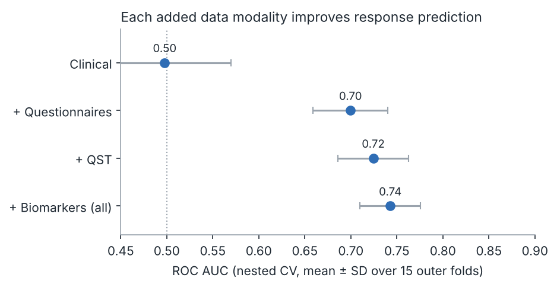
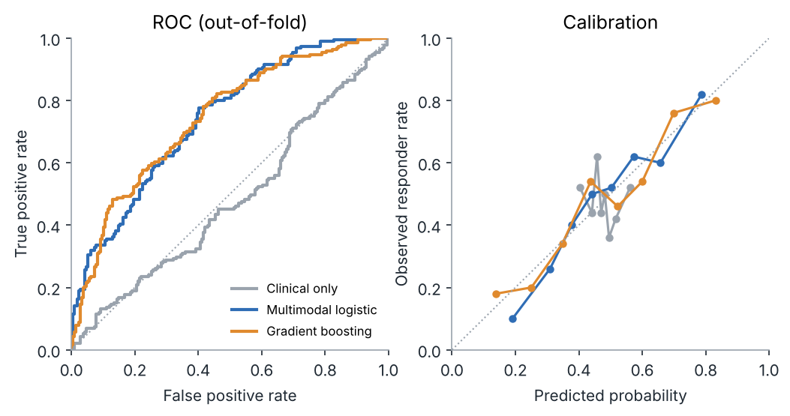
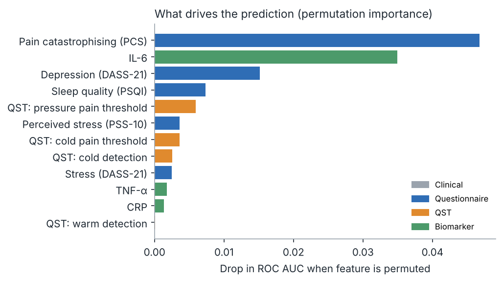
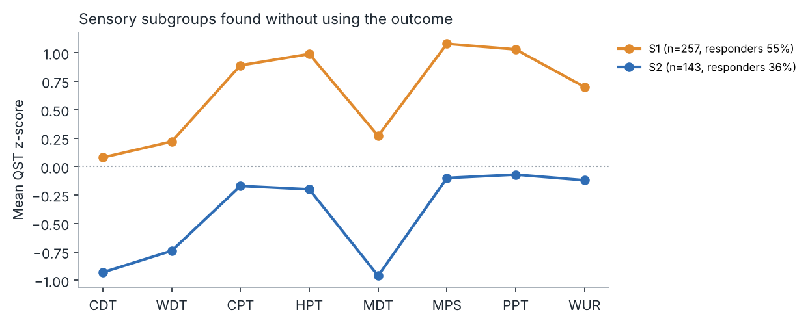

# Treatment-response prediction in a multimodal pain cohort


Can we tell, before treatment starts, which chronic-pain patients will respond? This project integrates four data modalities, finds patient subgroups without looking at the outcome, and predicts treatment response with nested cross-validation.

> **The data are simulated.** They follow the structure of a real clinical pain study (demographics, quantitative sensory testing, validated questionnaires, a serum biomarker panel and pre/post pain ratings), but no real participant data are used. The equivalent analysis on real cohort data is internal and not shared. A simulated dataset with known ground truth also lets the pipeline be checked: we know which signals it *should* find.

## Results at a glance

| Model (nested CV, 5 folds × 3 repeats) | ROC AUC | Brier score |
| --- | --- | --- |
| Logistic regression – clinical only | 0.50 ± 0.07 | 0.254 |
| + questionnaires | 0.70 ± 0.04 | 0.222 |
| + quantitative sensory testing | 0.72 ± 0.04 | 0.214 |
| + serum biomarkers (all modalities) | **0.74 ± 0.03** | **0.207** |
| Gradient boosting – all modalities | 0.73 ± 0.02 | 0.212 |

400 simulated participants; 47.8 % responders (≥ 30 % pain reduction, IMMPACT threshold).

**1. Each added modality improves prediction.** Demographics alone are at chance; patient-reported outcomes carry most of the signal; sensory testing and biomarkers add on top.



**2. The model is well calibrated, and a regularised linear model matches gradient boosting.** With a few hundred patients, the simpler and more interpretable model is the better choice.



**3. The drivers match the simulated biology.** Pain catastrophising, IL-6, depression and sleep were built into the ground truth, and permutation importance recovers them in that order.



**4. Sensory subgroups differ in response rate.** Clustering on QST profiles alone (silhouette chose k = 2) separates a sensitised subgroup (55 % responders) from a sensory-loss subgroup (36 %; χ² p < 0.001). The simulation had three phenotypes; the data-driven split merges the intermediate one (adjusted Rand index 0.37). That is a realistic limitation: overlapping phenotypes are hard to separate from eight sensory measures.



## What the pipeline does

1. **Simulate** a cohort with known ground truth and realistic missingness (`src/prp/simulate.py`).
2. **Stratify** patients on sensory profiles with k-means, choosing k by silhouette (`stratify.py`).
3. **Predict** response with nested cross-validation: hyperparameters are tuned in the inner loop, performance is measured only on outer test folds, and imputation and scaling are fitted inside each training fold so no test information leaks (`model.py`).
4. **Report** metrics as JSON and figures (`run.py`, `plots.py`).

## Reproducibility

- **One command:** `make all` (or `pip install -r requirements.txt && pip install -e . && python -m prp.run`).
- **One config:** seed, cohort size, missingness and CV settings live in `config.yaml`.
- **Pinned environment:** exact package versions in `requirements.txt`.
- **Tests:** `pytest` checks reproducibility, value ranges, the data dictionary, and a leakage guard (a shuffled outcome must give chance-level AUC).
- **CI:** GitHub Actions runs the tests and the full pipeline on every push and fails if `results/metrics.json` changes.
- **FAIR-oriented data:** `data/simulated_cohort.csv` ships with `data/data_dictionary.csv` (variable, modality, unit, description) and an open licence.

## Project structure

```
config.yaml               run settings
data/                     simulated cohort + data dictionary
results/metrics.json      all numbers in this README
results/figures/          all figures in this README
src/prp/                  simulate · stratify · model · plots · run
tests/                    unit and leakage tests
```

## Limitations

Simulated data cannot show how well this works on real patients; it shows that the method recovers known structure without leakage. Real cohorts are smaller, noisier and need external validation before any clinical use.

## Author

Deepika Singhal, PhD – [LinkedIn](https://www.linkedin.com/in/singhaldeepika14/) · [ORCID](https://orcid.org/0009-0004-5962-3613)

MIT licence.
